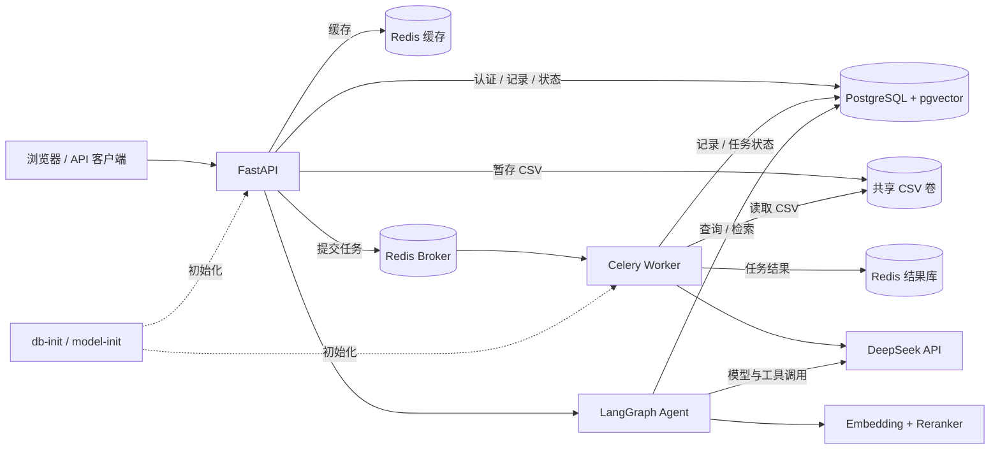
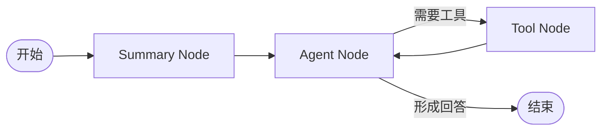

# UAV Flight Analysis System｜无人机飞行数据分析与 AI 助手

上传 CSV 飞行日志后，系统通过后台任务完成数据处理与 AI 报告生成；用户也可以用自然语言查询自己的飞行记录，或检索无人机知识。项目把 FastAPI、异步任务、数据库、RAG 与多轮 Agent 组合在一套应用中。

[快速开始](#快速开始) · [主要接口](#主要接口) · [系统架构](docs/architecture.md) · [技术设计](docs/technical-design.md) · [测试](#测试与验证) · [截图清单](assets/截图清单.md)

## 核心功能

- 注册登录、JWT 鉴权和用户数据归属校验，提供浏览器聊天页面和 API。
- 异步导入 CSV：校验与清洗数据，按飞行分组统计、检测异常并生成结构化报告。
- 查询飞行器与历史记录，更新记录时通过版本号检测并发冲突。
- 向量检索和重排知识资料，LangGraph 按问题调用飞行查询、分析或知识检索工具，支持多轮对话。
- 使用 pytest、TestClient 和 Postman 验证业务与接口，测试服务可与正式数据隔离。

## 技术栈与职责

| 组件 | 在项目中的作用 |
| --- | --- |
| FastAPI / Pydantic | API、输入输出校验；配合 JWT 和密码哈希实现登录 |
| Celery / Redis | 后台任务队列与结果；Redis 另用于飞行记录缓存 |
| PostgreSQL / psycopg / pgvector | 用户、飞行记录、任务状态、对话检查点和知识向量存储 |
| Pandas / NumPy | CSV 清洗、分组、统计与异常分析 |
| DeepSeek API | 生成飞行报告及 Agent 回复 |
| SentenceTransformer / BGE Reranker | 文本向量化与候选知识重排 |
| LangGraph / tiktoken | 工具调用流程、会话状态、摘要与上下文预算 |
| Docker Compose / pytest | 组织运行环境；测试业务和接口行为 |

## 系统架构



Compose 中 broker、结果和缓存使用同一 Redis 实例的不同逻辑库；图中分开表示职责。详见[架构文档](docs/architecture.md)。

## 核心业务流程

1. 用户登录，上传 CSV 与 UUID 幂等键；API 暂存文件、提交任务并返回任务 ID。
2. Worker 从共享卷读取文件，校验、清洗并按飞行分组；逐组生成报告后，在一个事务中写入记录。
3. 客户端查询任务状态与结果；任务和飞行记录均检查用户归属。
4. 对话时 Agent 按需调用飞行查询、分析或 RAG 工具，组织回答并保存会话状态。

CSV 必需字段：`uav_code,uav_model,manufacturer,flight_id,start_time,end_time,height,speed,battery,temperature`。时间格式为 `YYYY-MM-DD HH:mm`，按北京时间解释；同一 `uav_code` 和 `flight_id` 分为一次飞行，同组时间区间不能重叠。旧的 `data/data.csv` 不是当前上传格式。

## 项目结构

```text
├── api.py                 # Web 入口
├── app/                   # 路由、认证、Celery 任务、页面
├── src/
│   ├── flight_data/       # 数据处理与分析
│   ├── database/ cache/   # 数据访问与缓存
│   ├── rag/               # 向量检索、重排与评估
│   ├── agent/             # LangGraph、工具与上下文
│   └── llm/               # 模型调用与报告生成
├── sql/ scripts/          # 数据库初始化与维护
├── tests/ verification/   # 基础测试与专项验证
├── examples/ data/        # 示例与知识资料
├── docs/ assets/          # 文档与展示素材
├── compose.yaml Dockerfile
└── requirements.txt requirements-dev.txt
```

`archive/learning/` 是历史学习代码，不是当前 Web Agent 的入口。

## 快速开始

需要 Docker 和 Docker Compose。测试配置使用 `!override`，需 Compose 2.24.4 或更新版本。首次构建需要网络以安装依赖并准备模型和分词器，DeepSeek 调用需要可用的 API Key。

在项目根目录执行，已有 `.env` 时保留原文件：

```powershell
if (-not (Test-Path .env)) { Copy-Item .env.example .env }
# 编辑 .env，填写 PASSWORD、DEEPSEEK_API_KEY、JWT_SECRET_KEY
docker compose up -d --build api worker
docker compose logs -f db-init model-init api worker
```

默认访问 [登录页](http://127.0.0.1:8002/login) 或 [Swagger UI](http://127.0.0.1:8002/docs)。`db-init` 初始化数据库，`model-init` 准备模型与分词器；成功退出后 API 与 worker 才启动。初始化不创建示例用户或飞行记录，请先注册并上传符合格式的 CSV。

测试服务与正式服务使用不同数据库、Redis 逻辑库和上传卷：

```powershell
if (-not (Test-Path .env.test)) { Copy-Item .env.test.example .env.test }
# 编辑 .env.test，设置不同于正式环境的 JWT_SECRET_KEY
docker compose -f compose.yaml -f compose.test.yaml up -d --build api-test worker-test
```

测试入口默认 `http://127.0.0.1:8003`。已有旧数据库升级前应备份并阅读 [SQL 初始化说明](sql/README.md)；其他部署选项见[部署文档](docs/deployment.md)。

### 环境变量

| 变量 | 作用 |
| --- | --- |
| `DEEPSEEK_API_KEY` | 模型 API 凭据 |
| `PASSWORD` | Compose PostgreSQL 密码 |
| `JWT_SECRET_KEY` | JWT 签发密钥，至少 32 字符；测试环境使用独立密钥 |
| `UAV_API_PORT` / `UAV_TEST_API_PORT` | 宿主机端口，默认 8002 / 8003 |
| `UAV_DB_HOST` / `UAV_DB_PORT` / `UAV_DB_NAME` | 数据库连接信息；Compose 指定容器地址与对应库 |
| `CELERY_BROKER_URL` / `CELERY_RESULT_BACKEND` / `REDIS_CACHE_URL` | 队列、结果与缓存地址；Compose 已配置 |
| `CSV_UPLOAD_DIR` | API 和 worker 共用的 CSV 暂存目录；Compose 使用共享卷 |

配置保存在本地 `.env`，不要提交到 Git。直接在宿主机运行 Python 时，项目不会自动加载 `.env`；还需配置可访问的 PostgreSQL、Redis 和共享暂存目录。

## 主要接口

| 方法与路径 | 说明 |
| --- | --- |
| `POST /auth/register`、`POST /auth/login` | 表单注册、登录；浏览器使用登录 Cookie |
| `POST /ai_flight/flights/report` | 上传 `file` 和表单字段 `idempotency_key`（UUID），返回任务 ID |
| `GET /ai_flight/report/jobs/{task_id}` | 查询本人任务状态及结果 |
| `POST /ai_flight/flights/{record_id}/report/jobs` | 提交单条记录报告任务；UUID 放在 `Idempotency-Key` 请求头 |
| `GET /flight/uavs`、`GET /flight/flights` | 查询本人飞行器与历史记录 |
| `GET /flight/flights/{record_id}`、`PUT /flight/flights/{record_id}` | 读取和按版本更新飞行记录 |
| `POST /ai_flight/assistant/model` | 提交自然语言问题；续聊传入上次返回的 `thread_id` |

业务接口按各自依赖要求登录，支持 Cookie 或 Bearer JWT。CSV 重复提交同一用户的幂等键返回 409 和原任务 ID；单条报告的 409 响应结构与上传接口不同。投递状态不确定时保留原键并按响应中的任务 ID 查询。完整字段以 Swagger 和代码为准。

## 技术亮点

### 异步任务与并发控制

API 把文件暂存到共享卷，队列只传文件标识等参数；数据库唯一约束按用户和幂等键限制重复提交。Worker 认领任务后通过 heartbeat 续租，写入时检查租约；watchdog 将过期租约重置为可重试状态，后续执行依赖 Celery 消息重投递。任务 ID、写入检查与事务用于降低重复写入风险，不能据此宣称端到端恰好一次。记录更新使用 `version` 乐观锁，冲突返回 409。

### RAG 检索

`intfloat/multilingual-e5-base` 将查询向量化，在 pgvector 中按余弦距离 Top-K 召回，可按 `metadata.type` 过滤并按距离阈值筛选，再用 `BAAI/bge-reranker-base` 重排。`src/rag/evaluation.py` 提供重排前后评估函数；其中 `mean_recall` 实际是问题级主题命中率。当前没有附可核验的评测结果。

### LangGraph Agent



状态包含问题、消息、工具结果、摘要、摘要游标和最终回答。工具包括飞行查询、分析及知识检索；Web 端使用 PostgreSQL 检查点恢复会话。上下文按 token 预算选取，旧对话可增量摘要；报告用 Pydantic `FlightReport` 校验，助手接口响应使用 `AssistantResponse`。

## 测试与验证

```powershell
if (-not (Test-Path .venv)) { uv venv --python 3.11 .venv }
uv pip install --python .venv\Scripts\python.exe -r requirements-dev.txt
.\.venv\Scripts\python.exe -m pytest tests verification -q
node --test tests/test_csv_upload_ui.cjs
```

`tests/` 和 `verification/` 包含 fixture、monkeypatch、TestClient 与专项用例，覆盖权限、幂等、任务租约、缓存和图状态等；替身测试不等同于真实数据库、队列或模型联调。部分实库测试需显式启用，Compose 配置测试需要本机 Docker；详细前提见[部署文档](docs/deployment.md)和测试文件。Postman 可在独立测试环境验证登录、上传、轮询及重复提交；执行前确认目标为测试端口。

## 运行效果展示

系统架构和 Agent 工作流已在上文以 Mermaid 展示。Swagger、Postman、pytest、AI 报告及 RAG 对照截图需要从实际运行中采集；内容与步骤见[截图清单](assets/截图清单.md)。添加截图前请脱敏。

## 已知限制与后续方向

- 任务重投递依赖 broker 和 worker 状态；消息投递不确定、模型调用失败或缓存失效需要按实际状态处理。
- 知识库需先导入；评估结果依赖数据集与模型，当前未附经过核验的指标。
- 模型下载、DeepSeek API、数据库和 Redis 是完整流程的外部依赖；测试替身不能证明在线服务可用或并发性能。
- 后续可补充真实环境端到端验证、可复现的检索对照结果、并发压测与可观测性；这些均为待完成工作。
