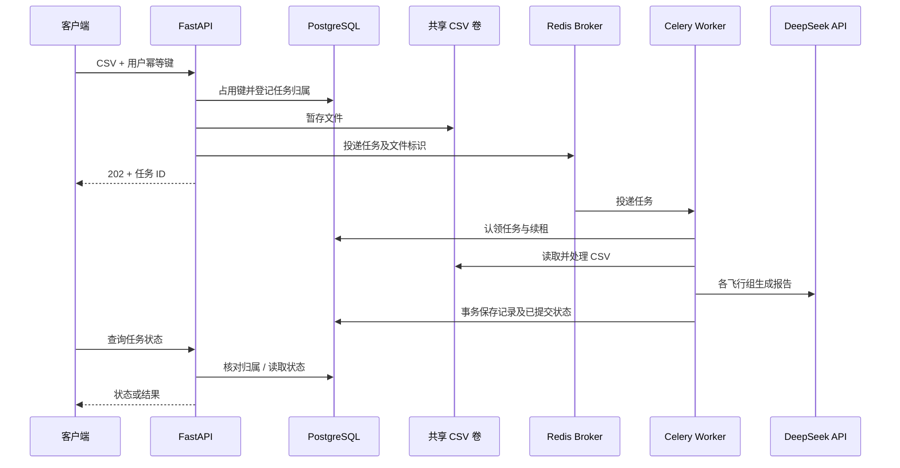

# 系统架构

本项目由 FastAPI 应用、Celery worker、PostgreSQL/pgvector 和 Redis 组成。部署服务及依赖关系以根目录 `compose.yaml` 为准；API 和 worker 分别使用相同镜像和不同启动命令。系统总览图与 Agent 图见[项目首页](../README.md)。

## HTTP 请求

浏览器通过 `/register`、`/login` 注册登录，服务端签发 JWT 并设置 Cookie；API 客户端也可通过 Bearer token 使用受保护接口。路由通过依赖获取身份及用户数据作用域，仓储查询和缓存按用户隔离。飞行记录更新使用客户端提供的 `version` 检测冲突，更新后失效相关缓存。并非所有接口都有登录依赖，具体以各路由为准。

## CSV 与异步任务

上图把多个步骤简化在一起；实际先占用幂等键、暂存文件，再登记任务及投递。投递状态不确定时 API 返回 503 并保留任务信息。Worker 对成功或失败的终态任务尝试清理文件，失去租约等待重投时保留文件。任务状态和结果查询先检查归属。

## 数据和缓存

PostgreSQL 保存用户、飞行器、飞行记录、幂等键、任务状态和 Agent 检查点；`documents` 保存文本、JSONB metadata 和 768 维向量。Redis 分别承担 broker、结果后端和查询缓存；正式配置使用逻辑库 0/1/2，测试配置使用 3/4/5。业务缓存包含用户范围；数据库写入后失效相关缓存，失效失败有专门错误响应。

`db-init` 创建并初始化正式库与测试库；`model-init` 准备 embedding、reranker 和分词器缓存。PostgresSaver 的检查点表由 API 启动时的 `setup()` 创建或升级。

## Agent 和知识检索

`src/agent/graph/graph.py` 入口先运行 summary，再进入 agent；agent 有工具调用时进入 tool，执行后返回 agent，否则产生最终回答。状态含问题、上下文、消息、待调用工具、工具结果、摘要及游标。Web 端按 `thread_id` 和用户归属恢复检查点；独立演示默认使用内存检查点。

RAG 先将问题向量化，按余弦距离检索 `documents`，可筛选 `metadata.type`，再用 CrossEncoder 对候选结果重排。Embedding 和重排模型由应用初始化提供给工具；外部模型回答以工具返回内容为上下文，不能代替对真实飞行安全的判断。
